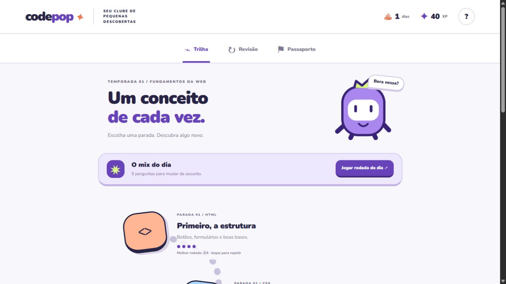

# CodePop

**Um conceito de cada vez.** Um clube de microdesafios de programação, com trilhas curtas, explicações e progresso de verdade.

[Experimentar a demonstração](https://gustapaz.github.io/codepop/)



## A experiência

- Seis trilhas: HTML, CSS, JavaScript, React, acessibilidade e navegador.
- 24 perguntas originais, exemplos de código e links para a documentação oficial.
- Um mix diário determinístico de cinco perguntas; sem cronômetro, vidas ou punição por parar.
- Revisão formada pelos erros reais; um acerto retira a pergunta da fila.
- 10 XP por conceito acertado pela primeira vez, melhor resultado por trilha e conquistas verificáveis.
- Rodadas retomáveis ao reabrir a aba, passaporte de progresso e exportação em texto.

## Stack e execução

Next.js 16, React, TypeScript, Tailwind CSS 4 e Vitest. Node.js 24.

```sh
npm ci
npm run dev
# Abrir http://localhost:3000/codepop/
npm test
npm run check
npm run build
npm run preview
# http://127.0.0.1:5190/codepop/
```

O build exporta HTML, CSS, JavaScript e fontes para `out/`. A base `/codepop` está configurada no Next. GitHub Actions verifica, testa, compila e publica no GitHub Pages.

## Dados e privacidade

Aplicação exclusivamente de front-end. Não há conta, servidor, API, banco, analytics, ranking ou serviço de IA. As perguntas são conteúdo estático; o progresso é calculado a partir das respostas e salvo no armazenamento deste navegador. Não há sincronização entre dispositivos. Limpar os dados do site remove o progresso; a exportação TXT é um relatório, não um backup importável. Se o armazenamento falhar, a interface avisa e continua em memória.

O código dos exemplos é somente texto e nunca é executado. Datas usam o dia local. Repetir uma pergunta não duplica o XP. Uma tentativa encerrada conserva respostas e erros, mas não registra conclusão de trilha.

## Direção e qualidade

A composição usa uma trilha vertical sinuosa, estações táteis, mascote vetorial próprio e feedback imediato inspirado em apps de aprendizado. Não reutiliza a narrativa em quadrinhos do Andar Zero, a bancada gráfica do Croma ou os mapas dos projetos anteriores. Leia [as decisões visuais](docs/design.md) e [a validação](docs/validacao.md).

Perguntas e explicações autorais, com referências à [MDN](https://developer.mozilla.org/) e à [documentação React](https://react.dev/). Demonstração de portfólio; não é um curso certificado nem tem vínculo com Duolingo ou com as marcas citadas nas perguntas.

## Licenças

Código e mascote: MIT, Gustavo Paz. Fontes locais Nunito e JetBrains Mono: SIL Open Font License, preservada em `docs/`. Dependências mantêm suas próprias licenças. Sem recursos pagos ou chaves.
